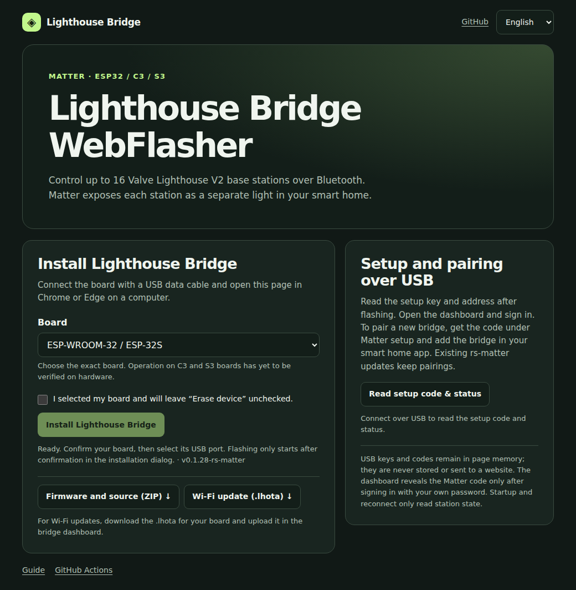

# Lighthouse Bridge

Control up to 16 Valve Lighthouse V2 base stations over Bluetooth from a local
dashboard, a local HTTP API, or a Matter controller. The bridge uses the
Rust rs-matter stack and presents each station as an individual Matter light.

[**Open the WebFlasher →**](https://traumlewis.github.io/Lighthouse-Bridge/) ·
[Setup guide](docs/WEBFLASHER.md) · [Version history](VERSION.md)

## Install and set up

1. Open the WebFlasher in desktop Chrome or Edge. Connect the board with a USB
   data cable, select its exact profile and leave **Erase device** unchecked.
2. Read the setup Wi-Fi name and key over USB. Join that Wi-Fi and open
   `http://192.168.4.1/` to connect the bridge to your home network or choose
   Local Mode.
3. Open the dashboard address shown over USB. Sign in with the setup key and
   choose a web password. Discover and assign your base stations.
4. In home-network mode, open **Matter Setup & Smart Home** in the dashboard.
   Generate a pairing code and add the bridge in your Matter controller.

| WebFlasher profile | Flash and hardware |
| --- | --- |
| ESP-WROOM-32 / ESP-32S | 4 MB or more, including CH340 USB-C boards |
| WeAct ESP32-C3FH4 | 4 MB |
| ESP32 C3 SuperMini | 4 MB |
| ESP32 S3 SuperMini | 4 MB flash, 2 MB QSPI PSRAM |

The classic ESP32 was tested with four physical stations and Alexa. The C3 and
S3 profiles have software build and packaging checks. Other Matter controllers
are listed in the dashboard and have yet to be verified with this bridge.

## Features

| Feature | What it provides |
| --- | --- |
| Station control | Switch individually or together, choose Sleep or Standby, and see measured state and reachability. |
| Matter | Pair over home Wi-Fi. Each station appears as an individual light. |
| Local and Remote modes | Connect directly over local Wi-Fi or use [GPIO buttons](docs/GPIO-BOARDS.md) for Bluetooth control from deep sleep. |
| Dashboard and [local API](docs/API.md) | Manage stations and access, inspect Bluetooth diagnostics, restart, or confirm a factory reset. |

For Wi-Fi updates, choose the `.lhota` that matches your board and upload it in
the dashboard. The OTA container validates the board chip and file integrity.
Use firmware from the project WebFlasher. Keep power connected until it restarts.

## Build

See [firmware build instructions](firmware/README.md) for pinned dependencies,
the four build commands, and local checks. GitHub Actions builds all four profiles
and deploys the verified files to the same WebFlasher.

## License

[MIT](LICENSE). See [protocol and dependency sources](docs/SOURCES.md) and the
third-party notices included in the firmware ZIP.
